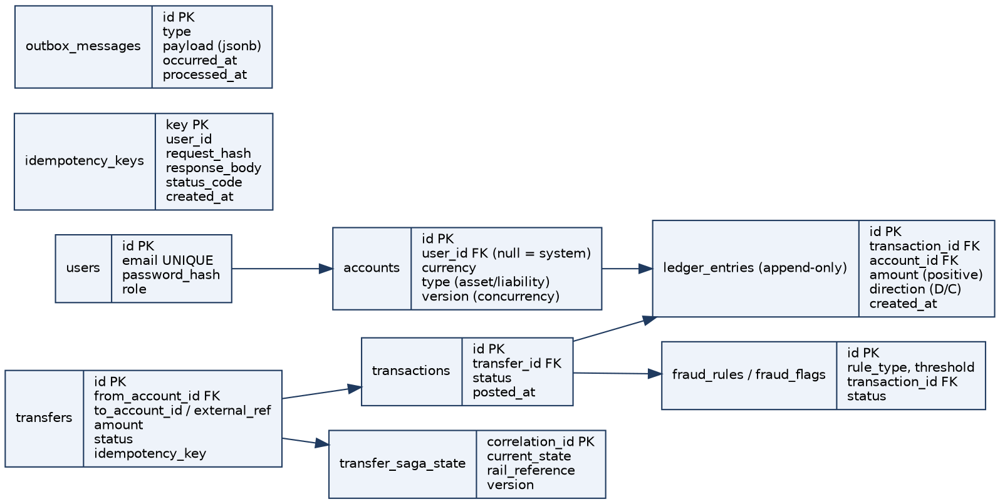
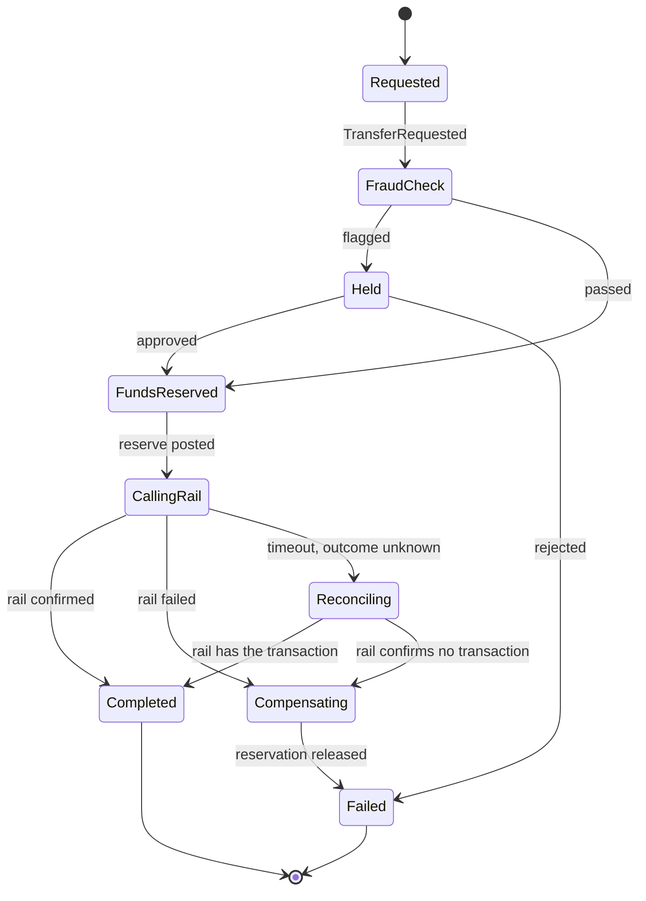

# Ledger Platform

**Design Document**

A double-entry ledger and payments platform built with ASP.NET Core, PostgreSQL, RabbitMQ and React, deployed as a modular monolith with one external service boundary.

**Repository:** github.com/mesale/ledger-platform

**Status:** Living document, updated through the ADRs in docs/architecture

**Delivery model:** Five stages, from a working ledger core to a deployed, observable platform. The architecture below describes the target system; Section 7 defines when each capability is delivered.

## Contents

1. [Overview](#1-overview)
2. [Architecture](#2-architecture)
3. [Domain Model](#3-domain-model)
4. [Data Model](#4-data-model)
5. [Key Mechanisms](#5-key-mechanisms)
6. [Repository Structure](#6-repository-structure)
7. [Delivery Plan](#7-delivery-plan)
8. [Testing Strategy](#8-testing-strategy)
9. [DevOps and Observability](#9-devops-and-observability)
10. [Collaboration Workflow](#10-collaboration-workflow)
11. [Stage 1 Repository Setup and Close-out](#11-stage-1-repository-setup-and-close-out)
12. [Risks and Open Questions](#12-risks-and-open-questions)

## 1. Overview

### 1.1 Purpose

This project is the backend a fintech would put behind its product: accounts, a double-entry ledger, transfers, and the guarantees real money-movement systems need (idempotency, consistency, auditability). External rails such as banks and card networks are simulated, but our own ledger is treated with production-grade rigor.

### 1.2 Goals

- Learn how professional full-stack and DevOps teams build and collaborate on a system with real complexity.
- Demonstrate backend rigor: correctness, concurrency control, resilience and auditability.
- Cover the whole delivery path: React frontend, CI/CD, infrastructure as code, observability, load and chaos testing.

### 1.3 Non-goals

- Real bank or card integrations, multi-currency FX, card issuing, KYC.
- Microservices for their own sake. Service boundaries exist only where a transaction cannot be shared.

Keeping the product surface to "accounts and transfers between them" lets effort go into correctness and resilience instead of feature breadth.

## 2. Architecture

### 2.1 Style: modular monolith with one external service

The core platform (API, ledger domain, saga orchestration, reconciliation, fraud rules) is one deployable ASP.NET Core application backed by one PostgreSQL database. Posting a balanced transaction therefore gets strong consistency from a single database transaction. The mocked external rail is a genuinely separate service, so cross-service failure modes (timeouts, partial failures, compensation) can be practised without a real bank.

| **Question**        | **Answer**                                                        |
|---------------------|-------------------------------------------------------------------|
| Deployment topology | Modular monolith plus one satellite service (Ledger.MockRail)     |
| Code organization   | Clean Architecture: Domain, Application, Infrastructure, Api      |
| Application pattern | CQRS with MediatR; commands post transfers, queries read balances |
| API style           | ASP.NET Core Web API returning JSON (not MVC views)               |

### 2.2 Technology stack

| **Area**      | **Choice**                                                                      |
|---------------|---------------------------------------------------------------------------------|
| Backend       | ASP.NET Core, MediatR, FluentValidation, EF Core                                |
| Database      | PostgreSQL (Serializable isolation for balance-affecting transactions)          |
| Cache         | Redis for idempotency lookups from Stage 2; derived balance projections checked by reconciliation from Stage 3 |
| Messaging     | RabbitMQ via MassTransit: outbox relay in Stage 2; persisted saga in Stage 3    |
| Auth          | ASP.NET Core Identity and short-lived JWTs in Stage 1; minimal admin access in Stage 3; refresh tokens and role management in Stage 4 |
| Frontend      | React and TypeScript, API client generated from OpenAPI                         |
| Observability | Serilog, OpenTelemetry, Prometheus and Grafana                                  |
| Delivery      | Docker Compose, GitHub Actions, Terraform or Bicep, Azure Container Apps or AKS |
| Testing       | xUnit, FsCheck property-based tests, Testcontainers, k6 or NBomber              |

### 2.3 How the architecture grows

The core remains one deployable application with one PostgreSQL database throughout all five stages. The mock rail adds the external service boundary in Stage 2.

| Stage | Capabilities added |
| --- | --- |
| 1 | Domain, Application, Infrastructure and Api projects; PostgreSQL via EF Core; Docker Compose; minimal auth and basic transfers |
| 2 | Redis idempotency lookup, RabbitMQ with MassTransit, outbox, notification consumer and standalone mock rail |
| 3 | Persisted transfer saga, reconciliation jobs, risk rules and minimal admin access |
| 4 | React frontend, refresh tokens and the full authorization model |
| 5 | Observability stack, chaos and load measurements, infrastructure as code and cloud deployment |

Redis and RabbitMQ containers are available in Compose in Stage 1; application use begins in Stage 2. Extracting notifications into another service is an optional stretch after the core stages.

### 2.4 Architecture decisions (ADR summary)

**ADR-001 Modular monolith over microservices.** Consistency matters most when posting a transaction, and a single database transaction gives it for free. Splitting early would add operational cost before the domain is proven. Revisit only for components that never join the ledger transaction, such as notifications.

**ADR-002 CQRS with MediatR.** Commands (post a transfer) and queries (get balance, list transactions) have different needs. Separate handlers keep pipeline behaviours (validation, logging, idempotency) in one place.

**ADR-003 Web API, not MVC.** The system returns JSON, so controllers or minimal endpoints are enough. Views are the React frontend's job.

**ADR-004 Sagas over two-phase commit.** The external rail cannot join our database transaction. A saga with compensation handles failure without distributed locks.

**ADR-005 Outbox over direct publish.** From Stage 2, events are written in the same transaction as the ledger entries and relayed asynchronously. Delivery is at least once: a crash after publishing can cause redelivery, so consumers must be idempotent.

**ADR-006 Derived balances.** Stage 1 computes balances directly from ledger entries and never stores an authoritative balance. From Stage 3, any cached projection is checked by reconciliation; entries remain the source of truth.

## 3. Domain Model

The double-entry ledger is the heart of the system. Every transaction touches at least two accounts, debits equal credits, and the ledger is append-only. Posted entries are never updated or deleted; corrections are new entries.

| **Concept**     | **Description**                                                                                                        |
|-----------------|------------------------------------------------------------------------------------------------------------------------|
| Money           | Decimal amount and ISO currency; never floating point. Arithmetic requires matching currencies.                     |
| Account         | Belongs to a user or is a system account (external funding, platform revenue, suspense, reservation). Has a currency, type (Asset, Liability, System) and status (active, frozen, closed). |
| LedgerEntry     | Immutable row: account, amount, direction (debit or credit), transaction id, timestamp.                                |
| Transaction     | Groups a balanced set of entries. Status: pending, posted, failed, reversed.                                           |
| Transfer        | User-facing request to send money from A to B. Results in one or more transactions.                                    |
| Idempotency key | Required for every balance-altering request; transaction key in Stage 1, request hash and stored response in Stage 2.   |
| Outbox message  | From Stage 2, an event written in the same database transaction as the ledger entries.                                  |

### 3.1 Core invariants

- Every transaction has at least two entries in one currency, and the sum of debits equals the sum of credits.
- Posted ledger entries are immutable.
- No account balance goes negative where the account type disallows it.
- A repeated request with the same idempotency key never creates a second transfer.
- Every domain event is published at least once and consumers are idempotent.
- Recomputing balances from entries always matches the cached balances (checked by reconciliation).

## 4. Data Model



*Figure 1: Target entity relationships (simplified), delivered across the stages rather than all in the initial migration. Column lists are indicative and will be finalised through EF Core migrations.*

### 4.1 Key design points

- ledger_entries is append-only. Enforce this with application code and, optionally, database rules or permissions.
- Stage 1 creates accounts, transactions and ledger entries, plus Identity persistence and seeded system accounts. Balances are derived from entries, never stored as the source of truth.
- accounts carries a version column for optimistic concurrency. Balance-affecting writes use `Serializable` isolation with bounded backoff on PostgreSQL serialization failure 40001. Measure contention in Stage 5 before considering repeatable read with optimistic concurrency.
- Idempotency is delivered in two steps. In Stage 1, `transactions.idempotency_key` has a unique index; a repeated key returns the original transaction, and a unique violation from a concurrent duplicate is resolved by returning the existing row. In Stage 2, the `idempotency_keys` table is added; it stores a request hash (so a reused key with a different body is rejected) and the original response for replay.
- Stage 2 adds outbox_messages with a processed_at column; the relay publishes unprocessed rows in order. Stage 3 adds persisted saga state and any derived balance projection required for reconciliation.
- All schema changes, including seed data and any append-only trigger, go through EF Core migrations.

## 5. Key Mechanisms

### 5.1 Idempotency

Every balance-altering endpoint, including transfers and Development-only funding, requires an `Idempotency-Key` header; a request without one is rejected with 400.

**Stage 1.** The key is stored on the transaction behind a unique index. A duplicate returns the original result and creates no second transaction. Concurrent duplicates are serialised by the unique constraint, so only one wins and the other returns the winner's result.

**Stage 2.** Middleware looks the key up (Redis first, Postgres as source of truth), compares a hash of the request body so a reused key with a different body is rejected, and replays the stored original response.

### 5.2 Atomic posting

In Stage 1, posting writes the transaction and all balanced entries in one `Serializable` database transaction, deriving balances from entries to check available funds. Serialization failures use bounded retries. Account concurrency checks and a consistent lock order protect against lost updates and double spends.

From Stage 2, the same database transaction also writes the outbox event. Any balance projection introduced for Stage 3 is updated atomically with its entries; it never replaces the ledger as the source of truth.

### 5.3 Outbox pattern

In Stage 2, events such as `TransferCompleted` are inserted into outbox_messages inside the ledger transaction. A background relay publishes them in order to RabbitMQ through MassTransit and marks them processed. If the process dies after commit but before publishing, the relay resumes on restart. A notification consumer proves the pipeline end to end; all consumers must tolerate duplicate delivery.

### 5.4 Transfer saga

In Stage 3, a transfer to the external rail is a persisted saga: check risk, reserve funds by moving them to a reservation account, call the rail, then confirm or compensate with new balancing entries. Use a MassTransit state machine or a hand-rolled state machine with a persisted saga table (ADR-004). Calls retry with backoff; a timeout where the rail may have succeeded triggers a status check before completing or releasing funds.



*Figure 2: Transfer saga state machine.*

| **State**     | **Next states**                      | **Notes**                                        |
|---------------|--------------------------------------|--------------------------------------------------|
| Requested     | FraudCheck                           | Saga instance created with correlation id        |
| FraudCheck    | Held, FundsReserved                  | Rules engine may hold for review                 |
| Held          | FundsReserved, Failed                | Admin approves or rejects                        |
| FundsReserved | CallingRail                          | Funds moved to a reservation account             |
| CallingRail   | Completed, Compensating, Reconciling | Retries with backoff before giving up            |
| Reconciling   | Completed, Compensating              | Query the rail for the real outcome              |
| Compensating  | Failed                               | Reservation released, never leave money in limbo |

### 5.5 Reconciliation

Stage 3 adds scheduled reconciliation and an on-demand report:

- Internal: recompute every account balance from raw entries and compare against any cached projection; alert on drift.
- External: compare our record of external transfers with the mocked rail's own ledger and flag mismatches.

### 5.6 Fraud and risk rules

Stage 3 adds a configurable rules engine evaluated before a transfer posts: velocity limits and large-amount holds. Flagged transfers appear in an admin queue for approval or rejection, accessible through minimal admin authorization. Stage 4 adds the admin UI and full role management.

### 5.7 Mocked external rail

Stage 2 delivers Ledger.MockRail as a standalone ASP.NET Core service with configurable latency and failure rate, including "timed out but may have succeeded". It keeps its own ledger so consistency with the platform can be verified in Stage 3. It has its own container and Compose service, with an HTTP client in Ledger.Infrastructure.

### 5.8 Security

- Stage 1: register and login with ASP.NET Core Identity and short-lived JWTs; ownership policies restrict reads and money movement to the user's accounts. Funding is available only in Development.
- Stage 3: a JWT role claim protects admin review and reconciliation endpoints; seed an admin user only in Development.
- Stage 4: refresh tokens, role management and full admin authorization policies; the frontend handles token refresh and expired sessions.
- Secrets via GitHub Secrets and a cloud key vault, never committed.

## 6. Repository Structure

One monorepo, so a single pull request can change a saga, its tests and the CI step that exercises it. The target structure grows according to Section 2.3; scaffolded projects do not imply that later-stage capabilities are implemented.

```text
ledger-platform/
├── src/
│   ├── Ledger.Domain/          # pure C#, no framework dependencies
│   ├── Ledger.Application/     # CQRS handlers by feature, sagas, interfaces
│   ├── Ledger.Infrastructure/  # EF Core, messaging, rail client, identity
│   ├── Ledger.Api/             # controllers, middleware, composition root
│   └── Ledger.MockRail/        # separate external-rail service, delivered in Stage 2
├── tests/                      # one test project per src project
├── frontend/                   # React + TypeScript, Stage 4
├── infra/                      # terraform or bicep, deployment manifests, Stage 5
├── docs/                       # architecture, ADRs, runbooks
├── .github/workflows/          # ci.yml, deploy.yml
├── docker-compose.yml
└── Ledger.sln
```

Dependency direction points inward only: Api, then Infrastructure, then Application, then Domain. Domain references nothing. Ledger.MockRail is not referenced by any other project.

Inside Application, organise by feature (Accounts/CreateAccount, Transfers/PostTransfer, Reconciliation, Fraud) rather than by technical type, so each vertical slice is easy to find.

## 7. Delivery Plan

The roadmap uses **Stage** for the five delivery phases below. Each stage ends with something demoable and testable. Weeks are indicative; adjust them to the team's pace.

| Stage | Focus | Indicative weeks | Demo at the end |
| --- | --- | --- | --- |
| 1 | Repo, CI, domain model, ledger core, basic transfer | 1-5 | Register, fund, transfer, replay a key safely, run everything with `docker compose up` |
| 2 | Idempotency, outbox, notifications, mock rail | 6-8 | Replay one transfer five times and get one transfer; an event survives a crash |
| 3 | Saga with compensation, reconciliation, risk rules | 9-11 | Transfers fail at three points and compensate; a reconciliation report catches an injected bug |
| 4 | Frontend, auth and authorization | 12-13 | A non-technical user creates an account and sends money; an admin panel shows the underlying state |
| 5 | Observability, chaos and load tests, deployment, write-up | 14-19 | `git push` deploys; one trace follows a transfer end to end; an engineering report with real numbers |

**Stages 1 to 3 are the non-negotiable core.** If time runs short, trim Stage 5 extras and Stage 4 polish before touching them. Refresh tokens, full authorization and required deployment checks remain part of their respective stage exit criteria.

### 7.1 Stage 1: Ledger core and basic transfer

**Goal.** A trusted double-entry ledger exposed over a secured HTTP API and backed by real PostgreSQL, where users can create accounts and move money between them. Every balance-altering write requires an idempotency key.

**Scope.**

- Repo and CI close-out: verify the setup checkpoint, add PR and issue templates, fix the README, commit the plan to `docs/` and create the project board (Section 11).
- Ledger.Domain: decimal `Money`, `Account`, immutable `LedgerEntry`, balanced `Transaction` aggregate, legal status transitions, reversals as new entries and FsCheck property-based tests.
- Ledger.Application: MediatR, FluentValidation, validation and logging pipeline behaviors, `CreateAccount`, `GetBalance` derived from entries, `PostTransfer`, paginated `ListTransactions` and Development-only funding.
- Persistence: EF Core with Npgsql, initial migration, `Serializable` isolation with bounded retry on 40001, append-only entries, seeded system accounts, shared Testcontainers fixture and concurrency testing.
- API and minimal auth: Dockerfile, `/health` with a database check, OpenAPI, `ProblemDetails`, Identity registration and login, short-lived JWTs, ownership policy, account and transfer endpoints and integration tests in CI.
- Lightweight idempotency: transfers and funding require `Idempotency-Key`, stored on `transactions.idempotency_key` behind a unique index. Duplicate keys return the original result, including concurrent requests.

**Tracked work.** 45 issues in five groups: repo and CI close-out (6), domain (8), application (8), persistence (10), API and minimal auth (13). See the detailed [Stage 1 plan](./stage-1-plan.md) for issue-sized tasks.

**Deferred.** Idempotency middleware, Redis lookup, request hashing, stored response replay, outbox and mock rail belong to Stage 2; sagas belong to Stage 3; refresh tokens and role management belong to Stage 4.

**Exit criteria.**

- [ ] Register and log in, receive a JWT
- [ ] Create two accounts, fund one, transfer between them and see correct balances
- [ ] Replaying a transfer with the same `Idempotency-Key` creates one transfer; a missing key returns 400
- [ ] A second user cannot read or move money from the first user's accounts
- [ ] An unbalanced transaction is rejected at the domain level
- [ ] Property-based tests run thousands of random transactions without breaking an invariant
- [ ] Integration tests run against real PostgreSQL in CI and CI is green
- [ ] `docker compose up` starts the API with PostgreSQL, Redis and RabbitMQ

### 7.2 Stage 2: Idempotency, outbox, notifications and mock rail

**Goal.** Make the system safe under retries and crashes, with an external service to exercise failure handling.

**Scope.**

- Full idempotency: middleware, Redis lookup with PostgreSQL as the source of truth, request hashing to reject key reuse with a different body and replay of the stored original response in `idempotency_keys`.
- Outbox events written atomically with ledger entries; a background relay publishes to RabbitMQ through MassTransit and marks messages processed in order.
- An idempotent notification consumer proves the event pipeline end to end. Extracting it into its own service is optional.
- Standalone mock rail with configurable latency, failures and ambiguous timeouts, its own ledger, a Dockerfile, a Compose service and an Infrastructure client.
- Tests for concurrent duplicate requests, a crash after commit but before relay and duplicate consumer delivery.

**Exit criteria.**

- [ ] The same transfer replayed five times creates one transfer and returns the same response
- [ ] A reused key with a different body is rejected
- [ ] An event is published after a crash between commit and relay
- [ ] The mock rail runs in Compose with controllable failures

### 7.3 Stage 3: Saga, reconciliation and risk rules

**Goal.** External transfers complete reliably or compensate cleanly under failure, and the system checks its own consistency.

**Scope.**

- Persist the saga states Requested, FraudCheck, Held, FundsReserved, CallingRail, Reconciling, Compensating, Completed and Failed (Section 5.4). Reserve funds first; release reservations through new entries when an external call fails.
- Retry rail calls with backoff. If a timeout leaves the result unknown, query the rail for the actual outcome before completing or compensating.
- Scheduled and on-demand reconciliation: recompute balances from raw entries, compare cached projections and alert on drift; compare external transfers with the mock rail's own ledger and flag mismatches.
- Configurable velocity limits and large-amount holds before posting, with an admin approval and rejection queue.
- Minimal admin access through a JWT role claim and an admin user seeded only in Development. Full role management follows in Stage 4.
- Chaos tests force failures at saga steps and verify a consistent final state.

**Exit criteria.**

- [ ] A transfer fails at three different points and the saga compensates each time
- [ ] No transfer is ever left with money in limbo
- [ ] A reconciliation report catches a deliberately injected bug
- [ ] A held transfer can be approved or rejected by an admin

### 7.4 Stage 4: Frontend, auth and authorization

**Goal.** Deliver user and admin interfaces with the complete authorization model.

**Scope.**

- React and TypeScript app with an API client generated from OpenAPI.
- User views for accounts, balances, a transfer form that generates its idempotency key on the client and transaction history.
- Admin views for reconciliation reports, held-transfer approval and rejection, and saga status for in-flight transfers.
- Polling for live updates; SignalR is optional.
- Refresh tokens, role management and admin-only authorization policies; frontend token refresh and expired-session handling.
- Frontend lint, build and unit tests in CI, a Dockerfile, a Compose service and a few end-to-end tests.

**Exit criteria.**

- [ ] A non-technical person can create an account and send money in the UI
- [ ] An admin can review held transfers and see the reconciliation report
- [ ] Non-admin users cannot reach admin endpoints or views
- [ ] The UI recovers cleanly from an expired token

### 7.5 Stage 5: Observability, chaos and load tests, deployment and write-up

**Goal.** Measure resilience and performance, ship through an automated pipeline and document the system so a stranger can run it.

**Scope.**

- Serilog structured logs and correlation ids through requests, sagas and events; OpenTelemetry traces across the API, saga steps and rail calls; metrics and Grafana dashboards on Prometheus or Azure Monitor.
- k6 or NBomber load and concurrency tests measuring throughput, latency and contention, likely around account-row locking. Relax `Serializable` only if measured results justify repeatable read with optimistic concurrency.
- Chaos tests in the deployed environment: kill a container or the rail mid-saga and verify recovery.
- Terraform or Bicep for Azure Container Apps or AKS, managed PostgreSQL, Redis and RabbitMQ or containerized equivalents; secrets in a key vault.
- GitHub Actions to test, build images, push to a registry, run migrations and deploy; separate dev, staging and prod environments with a documented rolling or blue-green strategy.
- Architecture and saga diagrams; ADRs for sagas over two-phase commit, isolation level and outbox over direct publish; a README a stranger can follow in 15 minutes; runbooks for stuck sagas; a reconciliation bug case study.
- An engineering report with measured throughput, p99 latency, failure recovery time, what broke first and what was tuned.

**Exit criteria.**

- [ ] `git push` results in an automated deploy to a real cloud environment
- [ ] A single trace follows one transfer from the API through the saga to the rail
- [ ] A dashboard shows throughput, saga failure rate, idempotency hit rate and drift count
- [ ] The engineering report has measured numbers
- [ ] A stranger can clone the repo and run it in under 15 minutes

## 8. Testing Strategy

- Stage 1: unit tests for invariants, FsCheck property-based tests over thousands of random transactions, Testcontainers integration tests against real PostgreSQL in CI, cross-user authorization tests and concurrency tests for lost updates, double spends and negative balances.
- Stage 2: concurrent duplicate requests, key/body mismatch, exact response replay, outbox crash recovery and idempotent consumers, with real PostgreSQL and RabbitMQ.
- Stage 3: saga failures at three different points, ambiguous-timeout recovery, reservation release, held-transfer review and reconciliation detecting deliberately injected drift or external mismatches.
- Stage 4: frontend lint, build and unit tests in CI; a few end-to-end tests for user transfers, admin permissions and expired sessions.
- Stage 5: deployed chaos tests and k6 or NBomber load tests, recording throughput, p99 latency, contention and recovery time in the engineering report.

Tests ship in the same PR as the code they cover. Distinct property-based, concurrency, shared-fixture, chaos and load concerns may be separate issues.

## 9. DevOps and Observability

- Stage 1: Docker Compose starts the API, PostgreSQL, Redis and RabbitMQ; GitHub Actions builds and tests, including PostgreSQL integration tests on every PR.
- Stage 2: add the mock rail to Compose and activate Redis and RabbitMQ integration.
- Stage 4: add the frontend Compose service, Dockerfile and frontend CI checks.
- Stage 5: automated image build, registry push, migrations and cloud deployment, with separate dev, staging and prod environments and documented rolling or blue-green delivery.
- Stage 5: Terraform or Bicep manages infrastructure and a key vault holds secrets; Serilog correlation ids and OpenTelemetry connect API, saga, event and rail activity.
- Stage 5: dashboards show transaction throughput, saga failure rate, idempotency hit rate and reconciliation drift count. Deployed chaos and load tests supply the engineering report's measured results.

## 10. Collaboration Workflow

- GitHub Flow: short-lived branches, protected main, pull request with passing CI and at least one review.
- Conventional commits, PR and issue templates, EditorConfig agreed before real code is written.
- ADRs for significant decisions; work tracked in GitHub Projects with weekly sprints.
- One issue per PR; target under 400 changed lines, maximum 500, excluding EF Core migrations, lockfiles and generated files.
- Branch names: `<type>/<issue-number>-<short-description>` with `feat`, `fix`, `refactor`, `test`, `docs` or `chore`; CONTRIBUTING.md permits `<type>/<short-description>` when there is no issue number.
- Assign yourself to an issue before starting. Ownership is per issue, with rotation across layers so both contributors understand the whole system.
- Stack feature PRs by layer: Domain, Application, Infrastructure, then Api. Tests accompany their implementation; distinct test concerns can be separate issues.
- All schema changes go through EF Core migrations.

Definition of done per issue: acceptance criteria met, domain invariants preserved, tests added, CI green, at least one approval, `.editorconfig` rules met and relevant documentation updated. See [CONTRIBUTING.md](../CONTRIBUTING.md) for the full workflow.

## 11. Stage 1 Repository Setup and Close-out

Repository setup and its close-out belong to Stage 1, within weeks 1-5. Verify existing scaffolding and configuration before adding missing pieces.

1. Verify the repository and solution scaffold: Domain, Application, Infrastructure and Api, matching test projects and inward-only references. A MockRail scaffold may exist, but service implementation belongs to Stage 2.
2. Verify `.gitignore`, `.editorconfig`, license, Compose dependencies and `.env.example`; enable the API service with its Dockerfile during Stage 1.
3. Verify the fresh-clone build and test checkpoint, green CI on main, and branch protection requiring a PR, one approval, passing CI and an up-to-date branch.
4. Add or verify PR and issue templates; fix the README and document local setup, including the JWT signing-key configuration without committing secrets.
5. Commit the Stage 1 plan to `docs/` and link it from the README.
6. Create or verify the GitHub Project board: Backlog, In progress, In review, Done. Assign work per issue.

Setup checkpoint: `dotnet build` and `dotnet test` at the repository root succeed and CI is green. The Stage 1 exit also requires the secured account and transfer demo and `docker compose up` starting the API with its dependencies.

## 12. Risks and Open Questions

| **Risk**                                 | **Mitigation**                                                                      |
|------------------------------------------|-------------------------------------------------------------------------------------|
| Serializable isolation causes contention | Bounded retry from Stage 1; measure in Stage 5 and relax only if justified           |
| Saga complexity                          | Start with a hand-rolled state machine or MassTransit saga; keep states few         |
| Scope creep                              | Keep to accounts and transfers; stretch goals after Stage 3; trim Stage 5 extras and Stage 4 polish first |
| Admin access needed before Stage 4       | Minimal JWT role claim and Development-only seeded admin in Stage 3; full model in Stage 4 |
| Unbalanced workload between two people   | Assign ownership per issue and rotate across layers                                |
| Cloud cost                               | Use student credits or free tiers; tear down environments after demos               |
