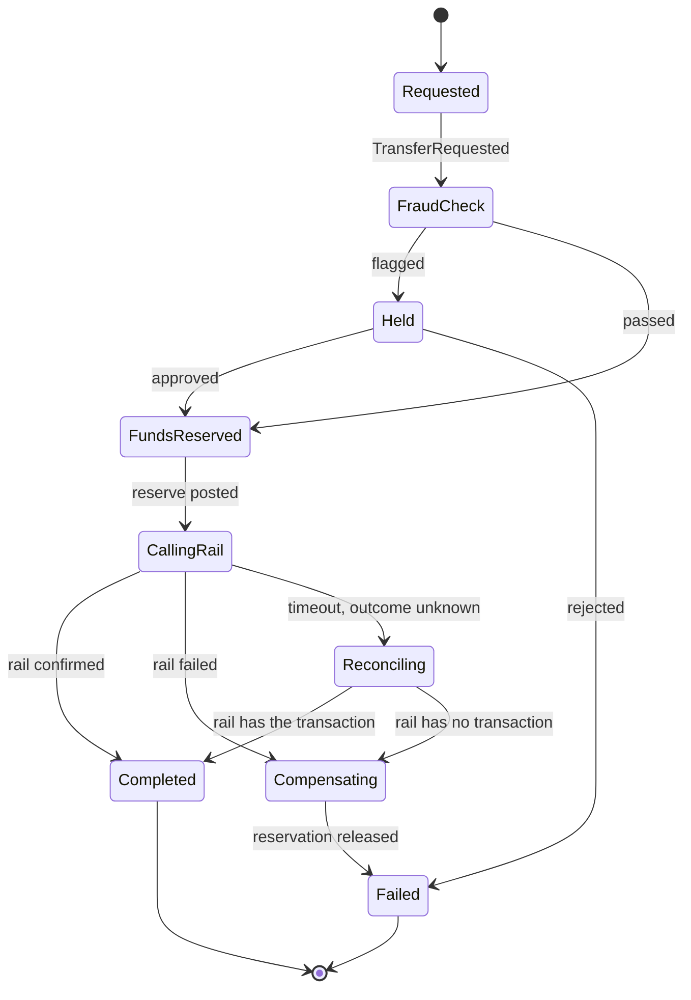

# Ledger Platform

**Design Document**

A double-entry ledger and payments platform built with ASP.NET Core, PostgreSQL, RabbitMQ and React, deployed as a modular monolith with one external service boundary.

**Repository:** github.com/mesale/ledger-platform

**Status:** Living document, updated through the ADRs in docs/architecture

## Contents

1. [Overview](#1-overview)
2. [Architecture](#2-architecture)
3. [Domain Model](#3-domain-model)
4. [Data Model](#4-data-model)
5. [Key Mechanisms](#5-key-mechanisms)
6. [Repository Structure](#6-repository-structure)
7. [Delivery Plan](#7-delivery-plan)
8. [Testing Strategy](#8-testing-strategy)
9. [DevOps and Observability](#9-devops-and-observability)
10. [Collaboration Workflow](#10-collaboration-workflow)
11. [Initial Repository Setup (Stage 0)](#11-initial-repository-setup-stage-0)
12. [Risks and Open Questions](#12-risks-and-open-questions)

## 1. Overview

### 1.1 Purpose

This project is the backend a fintech would put behind its product: accounts, a double-entry ledger, transfers, and the guarantees real money-movement systems need (idempotency, consistency, auditability). External rails such as banks and card networks are simulated, but our own ledger is treated with production-grade rigor.

### 1.2 Goals

- Learn how professional full-stack and DevOps teams build and collaborate on a system with real complexity.
- Demonstrate backend rigor: correctness, concurrency control, resilience and auditability.
- Cover the whole delivery path: React frontend, CI/CD, infrastructure as code, observability, load and chaos testing.

### 1.3 Non-goals

- Real bank or card integrations, multi-currency FX, card issuing, KYC.
- Microservices for their own sake. Service boundaries exist only where a transaction cannot be shared.

Keeping the product surface to "accounts and transfers between them" lets effort go into correctness and resilience instead of feature breadth.

## 2. Architecture

### 2.1 Style: modular monolith with one external service

The core platform (API, ledger domain, saga orchestration, reconciliation, fraud rules) is one deployable ASP.NET Core application backed by one PostgreSQL database. Posting a balanced transaction therefore gets strong consistency from a single database transaction. The mocked external rail is a genuinely separate service, so cross-service failure modes (timeouts, partial failures, compensation) can be practised without a real bank.

| **Question**        | **Answer**                                                        |
|---------------------|-------------------------------------------------------------------|
| Deployment topology | Modular monolith plus one satellite service (Ledger.MockRail)     |
| Code organization   | Clean Architecture: Domain, Application, Infrastructure, Api      |
| Application pattern | CQRS with MediatR; commands post transfers, queries read balances |
| API style           | ASP.NET Core Web API returning JSON (not MVC views)               |

### 2.2 Technology stack

| **Area**      | **Choice**                                                                      |
|---------------|---------------------------------------------------------------------------------|
| Backend       | ASP.NET Core, MediatR, FluentValidation, EF Core                                |
| Database      | PostgreSQL (Serializable isolation for balance-affecting transactions)          |
| Cache         | Redis for idempotency lookups and read-heavy balance queries                    |
| Messaging     | RabbitMQ via MassTransit (outbox relay and saga state machine)                  |
| Auth          | ASP.NET Core Identity or Keycloak, JWT plus refresh tokens                      |
| Frontend      | React and TypeScript, API client generated from OpenAPI                         |
| Observability | Serilog, OpenTelemetry, Prometheus and Grafana                                  |
| Delivery      | Docker Compose, GitHub Actions, Terraform or Bicep, Azure Container Apps or AKS |
| Testing       | xUnit, property-based tests, Testcontainers, k6 or NBomber                      |

### 2.3 Architecture decisions (ADR summary)

**ADR-001 Modular monolith over microservices.** Consistency matters most when posting a transaction, and a single database transaction gives it for free. Splitting early would add operational cost before the domain is proven. Revisit only for components that never join the ledger transaction, such as notifications.

**ADR-002 CQRS with MediatR.** Commands (post a transfer) and queries (get balance, list transactions) have different needs. Separate handlers keep pipeline behaviours (validation, logging, idempotency) in one place.

**ADR-003 Web API, not MVC.** The system returns JSON, so controllers or minimal endpoints are enough. Views are the React frontend's job.

**ADR-004 Sagas over two-phase commit.** The external rail cannot join our database transaction. A saga with compensation handles failure without distributed locks.

**ADR-005 Outbox over direct publish.** Events are written in the same transaction as the ledger entries and relayed asynchronously, so none are lost or duplicated.

**ADR-006 Derived balances.** Balances are computed from ledger entries (with a cached copy checked by reconciliation), which makes bugs visible.

## 3. Domain Model

The double-entry ledger is the heart of the system. Every transaction touches at least two accounts, debits equal credits, and the ledger is append-only. Posted entries are never updated or deleted; corrections are new entries.

| **Concept**     | **Description**                                                                                                        |
|-----------------|------------------------------------------------------------------------------------------------------------------------|
| Account         | Belongs to a user or is a system account (platform revenue, suspense). Has a currency and a type (asset or liability). |
| LedgerEntry     | Immutable row: account, amount, direction (debit or credit), transaction id, timestamp.                                |
| Transaction     | Groups a balanced set of entries. Status: pending, posted, failed, reversed.                                           |
| Transfer        | User-facing request to send money from A to B. Results in one or more transactions.                                    |
| Idempotency key | Stored per mutating request so retries never double-process.                                                           |
| Outbox message  | Event written in the same database transaction as the ledger entries.                                                  |

### 3.1 Core invariants

- For every transaction, the sum of debits equals the sum of credits.
- Posted ledger entries are immutable.
- No account balance goes negative where the account type disallows it.
- A repeated request with the same idempotency key never creates a second transfer.
- Every domain event is published at least once and consumers are idempotent.
- Recomputing balances from entries always matches the cached balances (checked by reconciliation).

## 4. Data Model


*Figure 1: Entity relationships (simplified). Column lists are indicative and will be finalised in the first migrations.*

### 4.1 Key design points

- ledger_entries is append-only. Enforce this with application code and, optionally, database rules or permissions.
- accounts carries a version column for optimistic concurrency. Balance-affecting writes use Serializable isolation first, measured and relaxed later if needed.
- idempotency_keys stores a request hash so a reused key with a different body is rejected.
- outbox_messages has a processed_at column; the relay publishes unprocessed rows in order.

## 5. Key Mechanisms

### 5.1 Idempotency

Every mutating endpoint accepts an Idempotency-Key header. Middleware looks the key up (Redis first, Postgres as source of truth). A duplicate returns the stored original response. Concurrent duplicates are serialised by a unique constraint so only one wins.

### 5.2 Atomic posting

Posting a transaction writes all entries, updates balances and writes the outbox message in one database transaction. Row-level locking or optimistic concurrency on accounts prevents lost updates and double spends, with a consistent lock order to avoid deadlocks.

### 5.3 Outbox pattern

Events such as TransferCompleted are inserted into outbox_messages inside the ledger transaction. A background relay publishes them to RabbitMQ through MassTransit and marks them processed. If the process dies after commit but before publishing, the relay resumes on restart.

### 5.4 Transfer saga

A transfer to an external account is a saga: reserve funds, call the external rail, then confirm or compensate. The unknown case (timeout where the rail may have succeeded) triggers a status check against the rail before deciding.



*Figure 2: Transfer saga state machine.*

| **State**     | **Next states**                      | **Notes**                                        |
|---------------|--------------------------------------|--------------------------------------------------|
| Requested     | FraudCheck                           | Saga instance created with correlation id        |
| FraudCheck    | Held, FundsReserved                  | Rules engine may hold for review                 |
| Held          | FundsReserved, Failed                | Admin approves or rejects                        |
| FundsReserved | CallingRail                          | Funds moved to a reservation account             |
| CallingRail   | Completed, Compensating, Reconciling | Retries with backoff before giving up            |
| Reconciling   | Completed, Compensating              | Query the rail for the real outcome              |
| Compensating  | Failed                               | Reservation released, never leave money in limbo |

### 5.5 Reconciliation

- Internal: recompute every account balance from raw entries and diff against cached balances; alert on drift.
- External: compare our record of external transfers with the mocked rail's own ledger and flag mismatches.

### 5.6 Fraud and risk rules

A configurable rules engine evaluated before a transfer posts: velocity limits, large-amount holds. Flagged transactions appear in an admin queue where they can be approved or rejected.

### 5.7 Mocked external rail

Ledger.MockRail is a standalone service with configurable latency and failure rate, including "timed out but may have succeeded". It keeps its own ledger so consistency with the platform can be verified.

### 5.8 Security

- JWT plus refresh tokens; users can only access accounts they own; admin role for reconciliation and fraud review.
- Secrets via GitHub Secrets and a cloud key vault, never committed.

## 6. Repository Structure

One monorepo, so a single pull request can change a saga, its tests and the CI step that exercises it.

```text
ledger-platform/
├── src/
│   ├── Ledger.Domain/          # pure C#, no framework dependencies
│   ├── Ledger.Application/     # CQRS handlers by feature, sagas, interfaces
│   ├── Ledger.Infrastructure/  # EF Core, messaging, rail client, identity
│   ├── Ledger.Api/             # controllers, middleware, composition root
│   └── Ledger.MockRail/        # separate external-rail service
├── tests/                      # one test project per src project
├── frontend/                   # React + TypeScript
├── infra/                      # terraform or bicep, deployment manifests
├── docs/                       # architecture, ADRs, runbooks
├── .github/workflows/          # ci.yml, deploy.yml
├── docker-compose.yml
└── Ledger.sln
```

Dependency direction points inward only: Api, then Infrastructure, then Application, then Domain. Domain references nothing. Ledger.MockRail is not referenced by any other project.

Inside Application, organise by feature (Accounts/CreateAccount, Transfers/PostTransfer, Reconciliation, Fraud) rather than by technical type, so each vertical slice is easy to find.

## 7. Delivery Plan

| **Stage**                  | **Weeks** | **Deliverable**                                                             |
|----------------------------|-----------|-----------------------------------------------------------------------------|
| 0 Setup                    | 1         | Empty API builds, runs in Docker, green CI                                  |
| 1 Core ledger domain       | 2-3       | Trusted ledger library with unit and property-based tests                   |
| 2 API, persistence, auth   | 4-5       | Working API: register, log in, create accounts, transfer, see balances      |
| 3 Idempotency and outbox   | 6-7       | Same transfer replayed 5 times creates one transfer; events survive crashes |
| 4 Mocked rail              | 8         | Independent external service with realistic failures                        |
| 5 Sagas                    | 9-10      | Transfers fail at three points and compensate correctly                     |
| 6 Reconciliation and fraud | 11        | On-demand reconciliation report that catches injected bugs                  |
| 7 Frontend                 | 12-13     | User and admin React app                                                    |
| 8 Observability            | 14        | Dashboards and an end-to-end trace of one transfer                          |
| 9 IaC and CI/CD            | 15-16     | git push deploys to a real cloud environment                                |
| 10 Load, chaos, hardening  | 17-18     | Engineering report with throughput, p99 latency, recovery time              |
| 11 Documentation           | 19        | Repo a stranger can run in 15 minutes                                       |

Stages 0 to 5 are the non-negotiable core. If time runs short, stages 6 onward can be trimmed without losing the impression of a serious system.

## 8. Testing Strategy

- Unit tests for invariants (debits equal credits, no illegal negative balances).
- Property-based tests: random sequences of transfers never violate invariants.
- Integration tests with Testcontainers (real PostgreSQL and RabbitMQ).
- Concurrency tests: many parallel transfers on one account show no lost updates or double spends.
- Chaos tests: kill the mocked rail or a container mid-saga and verify a consistent end state.
- Load tests with k6 or NBomber to find throughput limits and contention points.

## 9. DevOps and Observability

- Docker Compose for local development: API, PostgreSQL, Redis, RabbitMQ, mock rail.
- GitHub Actions: build, test, build images, push to registry, run migrations, deploy; separate dev, staging and prod.
- Infrastructure as code with Terraform or Bicep; rolling or blue/green deployment.
- Serilog structured logs with correlation ids; OpenTelemetry traces across API, saga and rail call.
- Metrics: transaction throughput, saga failure rate, idempotency hit rate, reconciliation drift count.

## 10. Collaboration Workflow

- GitHub Flow: short-lived branches, protected main, pull request with passing CI and at least one review.
- Conventional commits, PR and issue templates, EditorConfig agreed before real code is written.
- ADRs for significant decisions; work tracked in GitHub Projects with weekly sprints.

| **Owner** | **Stages**                                                                       |
|-----------|----------------------------------------------------------------------------------|
| Person A  | 1, 3, 5, 6: ledger core, idempotency and outbox, sagas, reconciliation and fraud |
| Person B  | 2, 4, 7, 9: API and auth, mocked rail, frontend, CI/CD and infrastructure        |
| Together  | 0, 8, 10, 11: setup, observability, load and chaos, documentation                |

Swap ownership during the final phase so both of you can speak fluently about every layer.

## 11. Initial Repository Setup (Stage 0)

1. Create an empty GitHub repo and clone it.
2. Scaffold the solution: dotnet new sln, classlib projects for Domain, Application and Infrastructure, webapi projects for Api and MockRail, xunit test projects; wire references inward only.
3. Add .gitignore (dotnet new gitignore), .editorconfig and a LICENSE if public.
4. Add a docker-compose.yml with postgres, redis and rabbitmq, each with a named volume.
5. Add .github/workflows/ci.yml: checkout, set up .NET, restore, build, test on every push and pull request.
6. Protect main: require pull request, passing CI and one review.
7. Write the README, make the initial commit, then open a trivial first pull request to prove the full loop.

Checkpoint: dotnet build at the repo root succeeds and CI is green.

## 12. Risks and Open Questions

| **Risk**                                 | **Mitigation**                                                                      |
|------------------------------------------|-------------------------------------------------------------------------------------|
| Serializable isolation causes contention | Measure in stage 10; relax to repeatable read with optimistic concurrency if needed |
| Saga complexity                          | Start with a hand-rolled state machine or MassTransit saga; keep states few         |
| Scope creep                              | Keep to accounts and transfers; stretch goals only after stage 5                    |
| Unbalanced workload between two people   | Ownership split by stage with a swap in the final phase                             |
| Cloud cost                               | Use student credits or free tiers; tear down environments after demos               |
